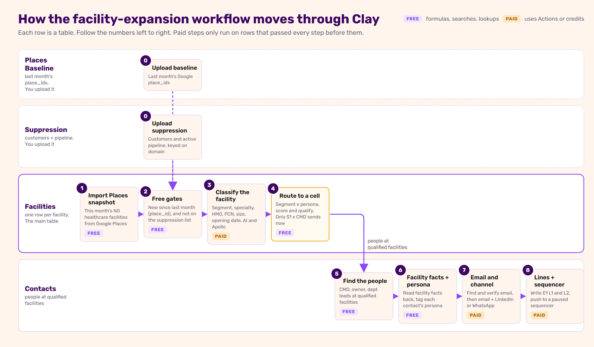

# Clay Build Guide: New Facility (DokiTab)

A step-by-step guide to building `output/campaigns/facility-expansion/workflow-spec.md` in Clay. Written for someone who has never built anything in Clay. Follow the parts in order. Each step tells you **why** it exists, **what to click**, **what to type**, **how to check it worked** and **what it costs**.

> **Don't skip the checks.** The most common Clay mistake is running a paid column on hundreds of rows before checking it worked on one. Every step below ends with a check. If a check fails, fix it before moving on.

---

## Contents

- [What you are building](#what-you-are-building)
- [Clay words you need](#clay-words-you-need)
- [Before you start](#before-you-start)
- [Part 0. Set up the workbook](#part-0-set-up-the-workbook)
- [Part 1. Reference tables (baseline and suppression)](#part-1-reference-tables)
- [Part 2. Import this month's Places snapshot](#part-2-import-this-months-places-snapshot)
- [Part 3. Free gates (new, and not suppressed)](#part-3-free-gates)
- [Part 4. Classify the facility](#part-4-classify-the-facility)
- [Part 5. Route the facility to a cell and qualify](#part-5-route-the-facility-to-a-cell-and-qualify)
- [Part 6. Find the people (Contacts table)](#part-6-find-the-people)
- [Part 7. Bring facility facts back and tag the persona](#part-7-bring-facility-facts-back)
- [Part 8. Find and verify the email, pick the channel](#part-8-find-and-verify-the-email)
- [Part 9. Write the email lines](#part-9-write-the-email-lines)
- [Part 10. Views for the operator](#part-10-views-for-the-operator)
- [Part 11. Connect the sequencer (build it, don't run it)](#part-11-connect-the-sequencer)
- [What it costs](#what-it-costs)
- [Final checklist](#final-checklist)
- [When something goes wrong](#when-something-goes-wrong)
- [Things the spec needs to fix](#things-the-spec-needs-to-fix)

---

## What you are building

The spec says: each month, take a fresh Google Places list of Nigerian healthcare facilities, keep only the ones that are **new since last month** (or have a dated opening announcement), drop anyone you already know, work out what kind of facility each one is, sort it into a segment (S1 to S5), find its people, and send a personalised Email 1 only to the **Chief Medical Director of a Lagos multi-specialty hospital or diagnostic center (cell S1 x Champion)**. Every other cell is built but held, because only the S1 x CMD copy is approved so far.

You will build **4 tables** inside **1 workbook**:



Each row of the picture is a table. The numbers are the order you build in. Step 0 is the two lists you upload first.

Why this shape:
- **Facility first (signal first)**, because the trigger happens to a facility (it opens / first appears on the map), not to a person.
- **Company checks happen once per facility** in the Facilities table, so you pay to classify a facility once, not once per person who works there.
- **Everything paid runs last**, and only on facilities that passed every free check before it.

What a finished row in **Facilities** looks like, reading left to right:

| Facility | place_id | City | New? | Segment | Specialty | Bills HMO? | HMO | Size | Cell | Score | Qualified? |
|---|---|---|---|---|---|---|---|---|---|---|---|
| Brightwell Hospital | ChIJ… | Ikeja | Yes | multi_specialty_hospital |  | Yes | Hygeia | 21-100 | S1 | 6 | Yes |

And a finished row in **Contacts**:

| Name | Title | Persona | Facility | Email | Channel | Ready? | E1 L1 | E1 L2 |
|---|---|---|---|---|---|---|---|---|
| Dr. A. Bello | Chief Medical Director | Champion (CMD) | Brightwell Hospital | a.bello@brightwell.ng | email + LinkedIn | Yes | Opening Brightwell Hospital in Ikeja usually means… | With Hygeia billing in the mix… |

---

## Clay words you need

| Word | What it means |
|---|---|
| **Workbook** | A folder of tables for one campaign. |
| **Table** | A spreadsheet. One row per facility or per person. |
| **Source** | Where a table's rows come from (a CSV, a Clay search, another table). |
| **Column** | One piece of information per row. Three kinds matter: **plain** (you type or import it), **formula** (Clay calculates it, free), **enrichment / action** (Clay calls a data provider or AI, usually costs). |
| **Formula** | A small spreadsheet-style calculation. Free. Clay has an AI helper: describe what you want in plain English and it writes the formula. |
| **Enrichment** | A column that looks something up (company size, a person, an email). Costs **Actions**, sometimes **Data Credits**. |
| **Use AI** | A column where an AI reads other columns in the row and answers. Costs about 1 Action plus a small AI cost. |
| **Claygent** | An AI column that browses the web to answer. Costs more than Use AI. |
| **Lookup** | A column that reads a matching row from another table in your workbook. Free. |
| **Send table data** | A column that copies rows from this table into another table. Free. |
| **Run condition** ("Only run if") | A rule on a paid column so it only runs on rows where the rule is true. This is how you avoid paying for rows you will throw away. |
| **Auto-run** | When on, new columns run on every row by themselves. **Keep it off** while building. |
| **Actions** | Clay's main usage meter. About 1 Action per enrichment per row. Unused Actions expire monthly. |
| **Data Credits** | A second meter, used when Clay pays a data provider for you (for example, email finders). |
| **View** | A saved filter on a table, like "only rows ready to send". |

---

## Before you start

Tick these off **before** the session. None of them should be done live.

- [ ] **Clay account** with access to the workspace you will build in. Note the plan (Settings → Plans & billing). You need roughly: number of facilities + number of people + email lookups in Actions. See [What it costs](#what-it-costs).
- [ ] **Connections** (Settings → Connections): Apollo (people and headcount), and an email finder if you use your own key. Without your own keys, Clay uses its own and charges Data Credits.
- [ ] **The spec is open** next to you: `output/campaigns/facility-expansion/workflow-spec.md`. Sections 2 (who is in and out), 4 (signals), 5 (cells) and 6 (variables) are what you are building. The approved copy is `output/campaigns/facility-expansion/copy.md`.
- [ ] **Two CSVs ready** (Part 1 shows exactly what goes in them): the **Places Baseline** (last month's `place_id`s) and the **Suppression** list (your customers and open deals).
- [ ] **This month's Google Places export** ready as a CSV (Part 2). You get this from the Google Places / Maps scrape that your n8n or Apify job runs; this guide does not scrape Google for you.
- [ ] **Test size: 25 facilities** for the first import. You can import more later.

> **One thing the spec assumes that Clay cannot do by itself:** the "monthly snapshot delta" (comparing this month's Google list to last month's) lives **outside Clay**, in an n8n job or a Google Sheet. This guide treats last month's `place_id`s as a CSV you upload (Part 1) and computes "new this month" with a free lookup (Part 3). See [Things the spec needs to fix](#things-the-spec-needs-to-fix).

---

## Part 0. Set up the workbook

**Why:** one place for everything in this campaign, so anyone can find it and follow it.

1. In Clay, click **+ New** (top left) → **Workbook**.
2. Name it: `DokiTab · New Facility (facility-expansion)`.
3. In the workbook description, paste: *"Signal: Nigerian healthcare facilities new on Google Places (or with a dated opening) in the last ~90 days. Spec: dokitab-gtm-os/output/campaigns/facility-expansion/workflow-spec.md. Only cell S1 x CMD sends; everything else is held."*

**Check:** the workbook appears in your Clay home with that name.
**Cost:** free.

---

## Part 1. Reference tables

### 1.1 Places Baseline (last month's facilities)

**Why:** "new this month" means "a `place_id` that was not in last month's list" (spec Signal 1). Clay cannot compare two monthly runs on its own, so you keep last month's list in a table and look against it.

1. Make a spreadsheet with **1 column**, `place_id`, holding every Google `place_id` from **last month's** snapshot. Save it as `places_baseline.csv`.
2. Inside the workbook, **+ Add table** → **Import CSV**. Upload it. Name the table `Places Baseline`.

> **First run (cold start):** if you have no previous month, upload this month's full snapshot here **and** import the same file in Part 2, so the first run marks nothing as new. Start sending from the **second** month. Otherwise the first run flags the entire map as new (spec Signal 1, cold-start note).

**Check:** the row count matches last month's facility count.
**Cost:** free.

### 1.2 Suppression (never contact)

**Why:** the spec (section 2, Exclude) says drop existing DokiTab workspaces, open pipeline, and competitors. Match on **domain** and on a normalized `facility_name + city` so a facility with no website is still caught.

Make a spreadsheet with **4 columns** and save it as `suppression.csv`:

| Facility Name | Domain | City | Type |
|---|---|---|---|
| {{fill from HubSpot: current customers}} | | | Customer |
| {{fill from HubSpot: open deals}} | | | Pipeline |
| {{known competitors you do not want to touch}} | | | Competitor |

- **Domain** is how most rows match. Type it plain, the way Clay shows domains: `brightwell.ng`. No `https://`, no `www.`, no trailing slash. Leave it blank rather than guess, and fill it from the facility's website or LinkedIn.
- **City** plus **Facility Name** catches facilities that have no website (many Nigerian clinics). Keep city names consistent (for example always "Lagos", not "LAG").

Import it as a table named `Suppression` (**+ Add table** → **Import CSV**).

**Check:** the row count matches your customer plus open-deal plus competitor count. Every row has either a domain or a name + city.
**Cost:** free.

---

## Part 2. Import this month's Places snapshot

**Why:** this is the raw universe (spec section 3, trigger source). Importing a CSV is free. You only pay later when you classify and enrich.

1. Export this month's Google Places list of Nigerian healthcare facilities to a CSV. It must include at least: `facility_name`, `place_id`, `city` (city_area), `neighborhood` (sublocality), a website if Places has one, and the Google review count. Keep it to **25 rows** for this first build.
2. Inside the workbook, **+ Add table** → **Import CSV**. Upload it. Name the table `Facilities`. This is the **main table**.
3. **Turn Auto-run OFF**: open the table's settings (the ⚙ or "…" menu at the top of the table) → **Auto-update / Auto-run** → off. Do this before adding any column.
4. Table settings → **Deduplicate** → choose `place_id`. One facility, one row.
5. Give the website/domain column the **URL** data type (column header → Edit column → Data type).

**Check:** 25 rows, each with a name, `place_id`, city, and a review count. Open 3 on Google Maps and confirm they are real healthcare facilities.
**Cost:** free.

---

## Part 3. Free gates

**Why:** drop rows you can reject for free before spending anything. Both columns here are free (a lookup and a formula).

**How to add a formula column:** **+ Add column** (right end of the table) → **Formula**. You can type the formula or click **Use AI** inside the formula box and describe it in plain English. When a formula refers to another column, type `/` and pick the column. Columns are written `{{Column Name}}` below.

### 3.1 `Seen Before` (lookup against Places Baseline)

1. **+ Add column** → **Lookup single row in other table**.
2. Table: `Places Baseline`. Match column in Places Baseline: `place_id`. Value from this table: `{{place_id}}`.
3. Save, then run on all rows (lookups are free).

### 3.2 `Is New Listing?`

- **Plain English:** *"True if Seen Before found nothing (the place_id was not in last month's baseline)."*
- **Formula:**
```javascript
!{{Seen Before}}
```
**Check:** a facility you know was in last month's baseline shows false; a brand-new one shows true.

### 3.3 `Suppression Match` (lookup against Suppression)

1. **+ Add column** → **Lookup single row in other table** → table `Suppression`, match `Domain` = `{{Domain}}`. Name it `Suppression Match (domain)`.
2. Add a second lookup for facilities with no domain: **Lookup single row in other table** → table `Suppression`, match on a normalized key. First add a free formula `Match Key` in both tables:
   - **Plain English:** *"Facility name and city, lowercased, letters and numbers only, joined by a dash."*
   - **Formula:** `(({{Facility Name}} || "") + "-" + ({{City}} || "")).toLowerCase().replace(/[^a-z0-9]+/g, "-")`
   - Then lookup `Suppression` on `Match Key` = `{{Match Key}}`. Name it `Suppression Match (name)`.

### 3.4 `Pass Free Gates?`

- **Plain English:** *"True if Is New Listing is true, Suppression Match (domain) found nothing, and Suppression Match (name) found nothing."*
- **Formula:**
```javascript
{{Is New Listing?}} === true && !{{Suppression Match (domain)}} && !{{Suppression Match (name)}}
```
**Check:** sort by `Pass Free Gates?`. Open the "false" rows and confirm each one deserves to be out (either not new, or on the suppression list). If a good row is false, fix the formula, not the row.
**Cost:** free.

---

## Part 4. Classify the facility

Everything here is paid, so each column gets a **run condition** of `{{Pass Free Gates?}} === true` and is proven on a few rows first. Run them in this order (cheapest judgement first).

### 4.1 `Enrich Facility` (size + review signal)

**Why:** `size_band` (spec Signal 6) has no bed data available in Clay, so you use employee headcount from Apollo as a proxy, plus the Google review count as a secondary volume signal.

1. **+ Add column** → **Enrich Company** (or **Apollo → Enrich Organization**). Input: `{{Domain}}` (fall back to `{{Facility Name}} + " " + {{City}}` if there is no domain).
2. **Run condition:** `{{Pass Free Gates?}} === true`.
3. Run on **1 row**, read the cell, then **Add as column**: `Employees`.
4. Run on the rest.

`Size Band` (free formula):
- **Plain English:** *"small if Employees is 1 to 20 or the Google review count is under 50, mid if 21 to 100, large if 100 or more or the review count is over 100."*
- **Formula:**
```javascript
({{Employees}} >= 100 || {{Review Count}} > 100) ? "large" : ({{Employees}} >= 21 ? "mid" : "small")
```
**Check:** pick 3 facilities and confirm the band by eye against their Maps/LinkedIn size. Bed-size numbers are `[INFERRED]`; the band is a proxy, not a bed count.
**Cost:** about **1 Action per facility**.

### 4.2 `Segment (AI)`: Use AI → the vertical

**Why AI and not a formula:** a Google category of "Hospital" does not tell you if it is a multi-specialty hospital, a standalone lab, or a single-specialty clinic, and the segment decides the whole angle (spec Signal 4).

1. **+ Add column** → **Use AI**.
2. Prompt:
   > *You are classifying a Nigerian healthcare facility by type.*
   >
   > *Facility: {{Facility Name}} ({{Domain}}), city {{City}}. Google categories: {{Categories}}. Description: {{Description}}.*
   >
   > *Return `segment`: `multi_specialty_hospital` (a hospital with several clinical departments and usually a diagnostic arm), `diagnostic_lab` (a standalone lab or imaging / PACS center), `pharmacy` (a retail or hospital pharmacy), `specialty_clinic` (one specialty only: dental, eye, physio, maternity), or `teaching_or_ngo` (a teaching hospital or a donor / NGO program). Use `unclear` only if the inputs do not say.*
   >
   > *Return `evidence`: one short fact from the inputs that supports it.*
3. Output format: **JSON**, with exactly these fields:
   - `segment`: text, one of `multi_specialty_hospital`, `diagnostic_lab`, `pharmacy`, `specialty_clinic`, `teaching_or_ngo`, `unclear`
   - `evidence`: text
4. **Run condition:** `{{Pass Free Gates?}} === true`.
5. Run on **3 facilities you can judge yourself**: one obvious multi-specialty hospital, one obvious pharmacy, one single-specialty clinic. Read each answer and its evidence. If one is wrong, fix the prompt and re-run the same 3, then run the rest.

> **`unclear` counts as "hold".** An `unclear` segment is not sent; it waits in a review view. Routing the wrong segment would send the wrong angle.

**Cost:** about **1 Action plus a small AI cost per facility**.

### 4.3 `Specialty (AI)`: Use AI, single-specialty clinics only

**Why:** for cell S4, copy needs the specific specialty (spec Signal 5, `{{specialty}}`). The segment enum only says `specialty_clinic`.

1. **+ Add column** → **Use AI**. Prompt: *"For {{Facility Name}} ({{Domain}}), categories {{Categories}}, bio {{Description}}, return `specialty`: one of `Dental`, `Eye / Optometry`, `Physiotherapy`, `Maternity / Fertility`, `Diagnostics / Lab`, `Multi-Specialty`."*
2. Output: **JSON**, `specialty` (the enum above).
3. **Run condition:** `{{Pass Free Gates?}} === true && {{Segment (AI)}}?.segment === "specialty_clinic"`.
4. Run on 2 clinics you can judge, then the rest.

**Cost:** about **1 Action plus a small AI cost per S4 clinic** (only runs on single-specialty clinics).

### 4.4 `Opening (Claygent)`: dated opening announcement

**Why:** spec Signal 2. A dated opening gives recency confidence and the `{{opening_ref}}` the copy can use. Without a reliable date, it is corroboration only and `Is New Listing?` carries recency.

1. **+ Add column** → **Claygent**.
2. Prompt:
   > *"Search the web (news, LinkedIn, Instagram, and Facebook via a `site:facebook.com` search) for a public post or article announcing that {{Facility Name}} in {{City}} has opened or is now open. Only count it if it carries a date in the last 90 days."*
   >
   > *Return `is_new_opening`: true only if you found a dated opening post within 90 days, else false. `opening_ref`: one short snippet or the URL. `opening_date`: the date if shown.*
3. Output: **JSON**, `is_new_opening` (true / false), `opening_ref` (text), `opening_date` (text).
4. **Run condition:** `{{Pass Free Gates?}} === true`.
5. Run on 2 or 3 facilities, read the evidence, then the rest.

> Facebook has no public search API, so this searches Google's index of Facebook, not Facebook itself. A Facebook Page "founded" date is **not** the opening date, so the prompt asks for a dated post. The richer Facebook path (a Google SERP step feeding an Apify Facebook Page scraper) runs **outside Clay** and can be imported as `is_new_opening` / `opening_ref` instead.

**Cost:** Claygent, **more than Use AI per facility** (it browses). Only runs on facilities that passed the free gates.

### 4.5 `Bills HMO?` (Claygent): HMO panel

**Why:** spec Signal 7, and it decides Email line 2.

1. **+ Add column** → **Claygent**. Prompt: *"Does {{Facility Name}} in {{City}} appear as an accredited provider for any Nigerian HMO or the Lagos ILERA EKO / LASHMA scheme? Search HMO provider directories (Hygeia, AXA Mansard, Avon, NHIA) and the ILERA EKO provider list."* Return `bills_hmo` (true / false), `hmo_name` (the matched HMO, or empty), `evidence`.
2. Output: **JSON**, `bills_hmo`, `hmo_name`, `evidence`.
3. **Run condition:** `{{Pass Free Gates?}} === true && {{Segment (AI)}}?.segment !== "teaching_or_ngo"`.
4. **Validate before scaling:** run on **1 facility you know is on an HMO panel and 1 you know is not**. Confirm both answers. Only then run the rest.

**Cost:** Claygent per facility. Validate on 2 rows first.

### 4.6 `PCN Verified?` (Claygent): pharmacies only

**Why:** spec Signal 10, for cell S3.

1. **+ Add column** → **Claygent**. Prompt: *"Is {{Facility Name}} in {{City}} a PCN-registered pharmaceutical premises? Check PCN (Pharmacy Council of Nigeria) listings and press."* Return `pcn_verified` (true / false), `evidence`.
2. Output: **JSON**, `pcn_verified`, `evidence`.
3. **Run condition:** `{{Pass Free Gates?}} === true && {{Segment (AI)}}?.segment === "pharmacy"`.
4. **Validate on 2 rows** (1 known positive, 1 known negative) before scaling.

**Cost:** Claygent per pharmacy. Validate first.

### 4.7 `Has Company Website?` (free formula)

- **Plain English:** *"True if the website domain is present and is not gmail, yahoo, hotmail or outlook."*
- **Formula:**
```javascript
!!{{Domain}} && !/gmail|yahoo|hotmail|outlook/i.test({{Domain}})
```
**Check:** a clinic on `brightwell.ng` → true. A clinic whose only contact is a gmail address → false.
**Cost:** free.

### 4.8 Clean copy variables (free formulas)

| Column | Plain English | Formula |
|---|---|---|
| `City Area` | The city, trimmed; fall back to neighborhood | `({{City}} || {{Neighborhood}} || "").trim()` |
| `Neighborhood Clean` | Neighborhood, or the city if blank | `({{Neighborhood}} || {{City}} || "").trim()` |
| `Bills HMO (flag)` | True if the Claygent HMO answer says true | `{{Bills HMO?}}?.bills_hmo === true` |
| `HMO Name` | The matched HMO, or empty | `{{Bills HMO?}}?.hmo_name || ""` |
| `Is New Opening (flag)` | True if the Claygent opening answer says true | `{{Opening (Claygent)}}?.is_new_opening === true` |
| `Opening Ref` | The opening snippet; else "a new listing in {Neighborhood}" | `{{Opening (Claygent)}}?.opening_ref || ("a new listing in " + {{Neighborhood Clean}})` |
| `Specialty` | The S4 specialty, or empty | `{{Specialty (AI)}}?.specialty || ""` |

> Only formula columns travel cleanly through the Part 7 lookup into Contacts, which is why the AI answers are copied into plain formula flags here.

**Cost:** free.

---

## Part 5. Route the facility to a cell and qualify

### 5.1 `Cell` (the segment)

- **Plain English:** *"S1 for multi-specialty hospital, S2 for diagnostic lab, S3 for pharmacy, S4 for specialty clinic, S5 for teaching or NGO, blank if unclear."*
- **Formula:**
```javascript
({"multi_specialty_hospital":"S1","diagnostic_lab":"S2","pharmacy":"S3","specialty_clinic":"S4","teaching_or_ngo":"S5"})[{{Segment (AI)}}?.segment] || ""
```

### 5.2 `Fit Score`

- **Plain English:** *"3 if Cell is S1, 2 if Cell is S2 S3 or S4, 0 otherwise; plus 2 if Is New Listing, plus 1 if Is New Opening, plus 1 if Bills HMO."*
- **Formula:**
```javascript
(({{Cell}} === "S1") ? 3 : (["S2","S3","S4"].includes({{Cell}}) ? 2 : 0)) + ({{Is New Listing?}} ? 2 : 0) + ({{Is New Opening (flag)}} ? 1 : 0) + ({{Bills HMO (flag)}} ? 1 : 0)
```

### 5.3 `Qualified?`

- **Plain English:** *"True if Pass Free Gates is true, Cell is S1 to S4 (not S5, not blank), and Fit Score is 4 or more. For S3 pharmacies also require PCN Verified."*
- **Formula:**
```javascript
{{Pass Free Gates?}} === true && ["S1","S2","S3","S4"].includes({{Cell}}) && {{Fit Score}} >= 4 && ({{Cell}} !== "S3" || {{PCN Verified?}}?.pcn_verified === true)
```

> S5 (teaching / NGO) rows keep their Cell but `Qualified?` is false: the spec deprioritizes them. S3 pharmacies that fail PCN verification are held the same way.

**Check:** filter `Qualified? = true`. Every row should be an S1 to S4 facility that is new and scores 4 or more. Read 3 of them against Google Maps.
**Cost:** free.

---

## Part 6. Find the people

**Why:** the campaign sends to people, not to buildings (spec section 2, recipient, and the personas). Searching is free.

1. In `Facilities`, create a view called `Qualified` (view dropdown at the top → **+ New view**) with one filter: `Qualified?` = true.
2. **+ Add table** → **Find people**. At the top of the filters, choose to find people **at companies from a table** (may be called "Companies from table"). Pick table `Facilities`, view `Qualified`.
   > **Why a view and not pasted domains:** the search stays tied to the view, so it always searches exactly the facilities that qualified. A pasted list is a snapshot and misses facilities that qualify next month.
3. **Job title: include**: Chief Medical Director · CMD · Medical Director · Consultant · Managing Director · Proprietor · Owner · Pharmacist · Superintendent Pharmacist · Laboratory Scientist · Billing Officer · Records Officer · Nurse (the Champion, Economic Buyer and Influencer titles from `personas.md`).
4. Import. Name the table `Contacts`. Turn **Auto-run off**. Add `Company Domain` as a column (open a cell in the source column → find company → domain → **Add as column**), and deduplicate on `LinkedIn Profile`.

**Check:** the Contacts table has people whose company domain matches a qualified facility. If a contact's domain is not in the `Qualified` view, drop it.
**Cost:** free.

---

## Part 7. Bring facility facts back

1. In `Contacts`: **+ Add column** → **Lookup single row in other table** → table `Facilities`, match `Company Domain` = `{{Company Domain}}`. Name it `Facility Facts`.
2. From one cell, **Add as column**: `Cell`, `Facility Name`, `City Area`, `Bills HMO (flag)`, `HMO Name`, `Is New Opening (flag)`, `Opening Ref`, `Specialty`, `Qualified?`.

### 7.1 `Persona` (free formula)

- **Plain English:** *"Champion if the title contains medical director, CMD or consultant; Economic Buyer if it contains owner, proprietor or managing director; otherwise Influencer."*
- **Formula:**
```javascript
/medical director|cmd|consultant/i.test({{Job Title}}) ? "Champion (CMD)" : (/owner|proprietor|managing director/i.test({{Job Title}}) ? "Economic Buyer" : "Influencer")
```

**Check:** a "Chief Medical Director" → Champion (CMD). A "Superintendent Pharmacist" → Influencer.
**Cost:** free.

---

## Part 8. Find and verify the email

**Why:** only look up emails for people you will actually contact. This is usually the most expensive step.

1. **+ Add column** → **Find work email** (Clay's email **waterfall**: it tries several providers in order until one finds an email). Inputs: full name `{{Full Name}}`, company domain `{{Company Domain}}`, LinkedIn `{{LinkedIn Profile}}`. Put any own-key provider first, then Clay's. **4 providers is enough.** Turn on **validation**, strict (no catch-all, no risky).
2. **Run condition:** `{{Qualified?}} === true && {{Cell}} === "S1" && {{Persona}} === "Champion (CMD)"`. This is the only cell with approved copy, so this is the only cell you pay emails for now.
3. Run on **1 row**, read the result (an email plus a "valid" status), then the rest.
4. **Add as column**: `Work Email` (type Email) and `Email Status`.

### 8.1 `Has Verified Work Email?` and `Channel` (free formulas)

| Column | Plain English | Formula |
|---|---|---|
| `Has Verified Work Email?` | True if Email Status is valid | `({{Email Status}} || "").toLowerCase() === "valid"` |
| `Channel` | email + LinkedIn if there is a verified work email, else WhatsApp / phone | `{{Has Verified Work Email?}} ? "email + LinkedIn" : "WhatsApp / phone"` |

> Spec Signal 9: channel is decided here, after the waterfall, not at routing time. Facilities with no verified email are not dropped; they go to the WhatsApp / phone view (Part 10).

**Check:** every row with an email shows status valid. Rows with no email show Channel = WhatsApp / phone.
**Cost:** Actions plus Data Credits **for each provider step that actually runs**.

---

## Part 9. Write the email lines

**Why:** Email 1's two dynamic lines are already written and approved for S1 x CMD (`copy.md`), so these are **formulas, not AI**. Free, and identical every time. The static lines (value prop, CTA, Emails 2 and 3, the LinkedIn DMs) and all spintax go into the **sequencer** verbatim, not into Clay.

Add these in `Contacts`. Each only needs to work on rows where `Ready to Contact?` is true.

### 9.1 `Ready to Contact?`

- **Plain English:** *"True if Qualified is true, Cell is S1, Persona is Champion (CMD), and there is a verified work email."*
- **Formula:**
```javascript
{{Qualified?}} === true && {{Cell}} === "S1" && {{Persona}} === "Champion (CMD)" && {{Has Verified Work Email?}} === true
```

> Every other cell and persona stays in the table with `Ready to Contact?` false. That is the spec's "build, don't send" rule: their copy is not written yet.

### 9.2 `E1 L1`: the opener (routes on the trigger)

- **Plain English:** *"If Ready to Contact is false, leave blank. If Is New Opening is true, write: Opening [Facility Name] in [City Area] usually means the records and billing setup is still being decided. Otherwise write: A new facility like [Facility Name] in [City Area] usually means the records system is still an open decision."*
- **Formula:**
```javascript
!{{Ready to Contact?}} ? "" :
{{Is New Opening (flag)}}
  ? "Opening " + {{Facility Name}} + " in " + {{City Area}} + " usually means the records and billing setup is still being decided."
  : "A new facility like " + {{Facility Name}} + " in " + {{City Area}} + " usually means the records system is still an open decision."
```
- **Check:** one row with Is New Opening true and one false. Facility and city read naturally, nothing blank. Wording matches `copy.md` exactly.

### 9.3 `E1 L2`: the situation (routes on Bills HMO)

- **Plain English:** *"If Ready to Contact is false, leave blank. If Bills HMO is true, write: With [HMO Name, or 'your HMOs' if blank] billing in the mix, clean claims from the first encounter tend to matter more than people expect early on. Otherwise write: Before patient volume builds, getting records and the audit trail right once is easier than fixing paper habits later."*
- **Formula:**
```javascript
!{{Ready to Contact?}} ? "" :
{{Bills HMO (flag)}}
  ? "With " + ({{HMO Name}} || "your HMOs") + " billing in the mix, clean claims from the first encounter tend to matter more than people expect early on."
  : "Before patient volume builds, getting records and the audit trail right once is easier than fixing paper habits later."
```
- **Check:** a Bills HMO row reads "With Hygeia billing in the mix…" (or "your HMOs" when the name is blank); a non-HMO row reads the audit-trail line.

### 9.4 Read the whole email

Pick one `Ready to Contact?` row. Paste its `E1 L1` and `E1 L2` into a document, put the greeting above, then the value-prop line, then the CTA (from `copy.md`), and read it out loud. If any line sounds wrong, fix the column that produced it, not the spec, unless the wording itself is wrong (then fix `copy.md` first, re-approve, and come back).

> **Spintax stays in the sequencer.** The value-prop line and CTA have options like `{puts wards, pharmacy, lab and billing on one record|runs the whole facility on one record}`. Paste those into the sequencer template, not into a Clay formula. Clay's `{{facility_name}}`, `{{first_name}}` and `{{city_area}}` are the only variables the sequencer fills.

**Cost:** free.

---

## Part 10. Views for the operator

In `Contacts`, create these views (view dropdown → add a filter):

| View | Filter | Who uses it |
|---|---|---|
| `Ready to send` | `Ready to Contact?` = true AND `Email Status` = valid | The person loading the sequencer |
| `WhatsApp / phone` | `Qualified?` = true AND `Cell` = S1 AND `Persona` = Champion (CMD) AND `Has Verified Work Email?` = false | The local rep (no email, reach on WhatsApp) |
| `Held: other cells` | `Qualified?` = true AND (`Cell` is not S1 OR `Persona` is not Champion (CMD)) | Waiting on copy for the other cells |
| `Review: unclear segment` | `Segment (AI)` is unclear | Hand-check the segment |

In `Ready to send`, hide helper formulas and keep: name, title, persona, facility, city, cell, email, `E1 L1`, `E1 L2`. Do not hide the paid columns or lookups: they show where the data came from.

---

## Part 11. Connect the sequencer

**Build this column, but do not run it.** Only the S1 x CMD copy is approved, sending inboxes are not confirmed warm, and `context/messaging/facts.md` does not exist yet, so no named proof or numbers are allowed in copy.

1. In the sequencer (Smartlead, Instantly or Clay's own), create a campaign called `DokiTab · New Facility · S1 CMD · E1`, and **leave it paused**. Put the subject options, greeting, `{{e1l1}}`, `{{e1l2}}`, the value-prop line, the CTA, Email 2, Email 3 and the two LinkedIn DMs into its template, copied verbatim from `copy.md`, keeping the spintax braces.
2. In `Contacts`: **+ Add column** → the sequencer's "Add lead to campaign" action.
3. Map: email `{{Work Email}}`, first name, company `{{Facility Name}}`, city `{{City Area}}`, and custom fields `e1l1` → `{{E1 L1}}`, `e1l2` → `{{E1 L2}}`.
4. **Run condition:** `{{Ready to Contact?}} === true && {{Email Status}} === "valid"`.
5. **Stop.** On launch day, run on 1 row, confirm the lead appears correctly in the paused campaign, then run the rest.

**Cost:** about **1 Action per lead pushed**. The emails themselves cost nothing in Clay.

---

## What it costs

Free: the CSV imports, the search, all formulas, lookups, Send table data, views.

Paid, and only on rows that passed every check before it:

| Step | Runs on | Rough cost |
|---|---|---|
| Enrich Facility (4.1) | Facilities that passed the free gates | 1 Action per facility |
| Segment (AI) (4.2) | Facilities that passed the free gates | 1 Action + small AI cost per facility |
| Specialty (AI) (4.3) | Single-specialty clinics only | 1 Action + small AI cost per S4 clinic |
| Opening (Claygent) (4.4) | Facilities that passed the free gates | More than Use AI per facility (browses) |
| Bills HMO (Claygent) (4.5) | Non-NGO facilities | Claygent per facility |
| PCN Verified (Claygent) (4.6) | Pharmacies only | Claygent per pharmacy |
| Email waterfall (8) | S1 x CMD, qualified only | Actions + Data Credits per provider step that runs |
| Sequencer push (11) | Valid emails only | 1 Action per lead |

**Example for the 25-facility test:** say 12 pass the free gates (the rest were seen last month or suppressed). Classifying those 12 is about 12 (Enrich) + 12 (Segment AI) + 12 (Opening Claygent) + maybe 10 (HMO Claygent) + 3 (PCN) + a couple of Specialty. Say 4 come out S1 and qualified, each with 1 CMD found: that is about 4 email waterfalls. Rough total **55 to 85 Actions**, more if the Claygent columns run on all 12, plus a few Data Credits for emails. Watch the Actions counter (top of Clay) before and after each paid step and write the numbers down.

---

## Final checklist

- [ ] Auto-run is **off** on every table.
- [ ] Every paid column has a **run condition**.
- [ ] Every paid column was tested on **1 row** (AI / Claygent on 2 to 3) and the cell was read before running more.
- [ ] `Facilities` has no duplicate `place_id`.
- [ ] No facility from `Suppression` is `Qualified?`.
- [ ] No S5 (teaching / NGO) facility is `Qualified?`.
- [ ] HMO and PCN Claygent columns were validated on 1 positive + 1 negative before scaling.
- [ ] Only S1 x Champion (CMD) rows are `Ready to Contact?`; every other cell is held.
- [ ] One sample email was read out loud and matches `copy.md`.
- [ ] Sequencer campaign exists, **paused**, push column built and **not run**.
- [ ] Actions spent are written down per step.

---

## When something goes wrong

| What you see | Likely cause | Fix |
|---|---|---|
| Every facility shows `Is New Listing? = true` | The Places Baseline is empty, or this is the first run | Seed the baseline with a full snapshot and start from month 2; confirm the baseline has last month's place_ids |
| A column ran on every row and spent Actions | Auto-run was on, or no run condition | Turn auto-run off; add the run condition; you cannot get Actions back, so note the spend |
| Lookup finds nothing | The two domains are written differently (`www.x.ng` vs `x.ng`) | Compare the two values; retype the Suppression domain plain, or strip `https://`, `www.` and the trailing slash in a formula before matching |
| A facility with no website never matches Suppression | It only has a name + city | Use the `Match Key` name lookup (Part 3.3); keep city names consistent |
| Segment (AI) returns `unclear` a lot | The Places description is thin | These sit in the `Review: unclear segment` view for a hand-check; do not send them |
| Bills HMO is wrong | HMO directories are fuzzy and names clash | That is why you validate on 1 positive + 1 negative and keep a confidence check; spot-check a sample each run |
| Email status is "catch-all" or "risky" | The facility's mail server accepts everything | Leave it out; the contact goes to the WhatsApp / phone view |
| `E1 L2` says "With  billing in the mix" | HMO Name is blank but Bills HMO is true | The formula already falls back to "your HMOs"; confirm you copied the `|| "your HMOs"` part |

---

## Things the spec needs to fix

Found while writing this guide. Update `workflow-spec.md` (not done here):

1. **Section 3, trigger source:** the monthly snapshot **delta** is not a Clay step. It lives in n8n or a Google Sheet; Clay only looks against an uploaded baseline (Part 1 and Part 3 here). The spec should say the delta is produced outside Clay and imported.
2. **Section 4, Signal 2 (opening):** the Facebook SERP-to-Apify pipeline runs outside Clay; inside Clay it collapses to one Claygent column (Part 4.4). When imported from n8n instead, `is_new_opening` / `opening_ref` arrive as plain columns.
3. **Section 4, Signal 6 (size):** there is no bed-count field in Clay or Apollo. The band is an employee-headcount proxy (1-20 / 21-100 / 100+) plus review count; the bed numbers stay `[INFERRED]`.
4. **Section 6, variables:** copy currently uses only `{{facility_name}}`, `{{city_area}}`, `{{hmo_name}}` and `{{first_name}}`. `{{opening_ref}}`, `{{specialty}}`, `{{neighborhood}}` and `{{first_seen_date}}` are built here but unused until the other cells get copy.
5. **Scope:** only cell S1 x CMD has approved copy, so only it can send. The guide builds and holds the other 11 cells. To send them, write their copy with `/campaign-copy`, then widen `Ready to Contact?`.
